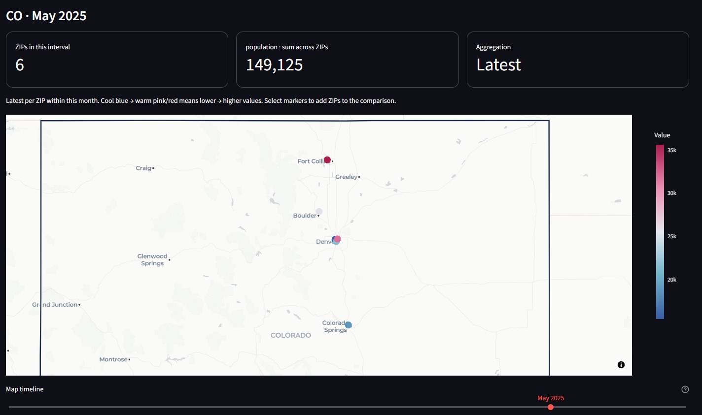

# ZIPtrend

A Python package and local browser dashboard for exploring numeric observations by U.S. ZIP code and time.



*Colorado demo view for May 2025, using fictional population data. Move the timeline to explore changes over time.*

## Install

Requires Python 3.11 or later.

```powershell
pip install "ziptrend[app]"   # data API plus the browser dashboard
pip install ziptrend          # data API only, without Streamlit or Plotly
```

## Run the dashboard

```powershell
ziptrend
```

The dashboard opens at http://localhost:8501. It binds to localhost by default. A fictional 36-month sample is included, with offline geography. Upload your own file or download the sample CSV from the sidebar.

## Explore

- Import CSV, TSV, delimited UTF-8 TXT, Excel XLS/XLSX (select a worksheet), JSON arrays, or JSON Lines.
- Map arbitrary column names to ZIP, date, and numeric measure. Select a different measure at any time.
- Select states, then search ZIPs by typing or paste a comma-, space-, or newline-separated list. Include selected ZIPs or exclude them from the entire dashboard.
- Use **Map timeline**, directly below the map, to step through days, months, or years according to **Time interval**. The map and its totals show only that interval. Optional date-range limits live in a collapsed sidebar section and narrow the timeline, trend charts, and exports.
- Select a state to frame its full Census outline instead of zooming to the cluster of ZIP centroids. Color scales use the filtered geography and displayed interval; enable **Keep color scale fixed over time** to compare intervals against one scale within those same geography filters.
- Switch between a cool-to-warm concentration heatmap and individually selectable ZIP markers. Click markers to add ZIPs to the searchable **Inspect ZIP codes** multiselect, or paste a list to compare several histories. Inspector selections only affect that comparison; sidebar ZIP filters affect the whole dashboard.
- Compare ZIP or state trends, view top ZIPs, and export observations or a map summary.

Example input:

```csv
zip,date,population
02108,2024-01-01,4500
02108,2024-02-01,4520
80202,2024-01-01,15000
80202,2024-02-01,15060
```

ZIPs retain leading zeros, Excel numeric ZIPs are padded, and ZIP+4 is reduced to five digits. Dates should preferably be ISO `YYYY-MM-DD`; years work too. Automatic ambiguous dates use month-first interpretation. Supply `%d/%m/%Y` for day-first dates. Numeric Excel serial dates must be converted to dates first. Values may contain thousands commas. Invalid rows and duplicate ZIP/date observations require correction or an explicit duplicate aggregation choice; records are not silently discarded.

## Aggregation and geography

`latest` (default) takes the final observation for each ZIP within each time interval on maps and trend charts. Use this for population snapshots. `mean` averages observations within the interval; `sum` adds them, appropriate for flows such as transactions. State curves sum the resulting ZIP values. Summing rates, percentages, or ZIP averages may not be meaningful; the package does not infer weights or denominators. State totals cover only uploaded ZIPs, and changing coverage can affect trends. Empty calendar intervals are included on the map timeline and display no values; no observations are carried forward. Optional date limits can clip a month/year. Exported map summaries correspond to the displayed interval; observation exports include the entire filtered range.

The concentration map blends values at ZIP centroids. It does **not** show ZIP boundaries or population per unit land area. Heatmap intensity depends on nearby points and zoom; marker colors scale to the map's aggregated values. With automatic scaling, the same color can mean different values in different intervals: read the legend or use the fixed-scale option. Signed values use marker views. Geographic ZIP attribution uses a representative state; postal ZIPs are not Census ZCTAs and may cross boundaries. ZIP boundary choropleths and land-area-normalized density remain future extensions.

Bundled state outlines are from the [U.S. Census Bureau's cartographic boundary files](https://www.census.gov/geographies/mapping-files/time-series/geo/carto-boundary-file.html), 2024, at 1:20,000,000 scale. They are simplified display boundaries, not survey boundaries. See `SOURCES.md` in the package's `assets` folder for the exact source and conversion details. State framing stays consistent across time bins even when the available ZIPs change. Basemap context outside a state's outline remains visible.

Default ZIP geography comes from [GeoNames](https://www.geonames.org/) through [pgeocode](https://pgeocode.readthedocs.io/en/latest/), with GeoNames attribution under [CC BY 4.0](https://creativecommons.org/licenses/by/4.0/). First use downloads a U.S. reference file; subsequent lookups use its local cache. Values in uploaded files are processed locally and are not sent to GeoNames. Basemap tiles come from CARTO/OpenStreetMap and require internet. Upload a CSV containing `zip,state,latitude,longitude` to use your own lookup without a reference download. Use two-letter state abbreviations. Missing geography is reported and retained for ZIP trends/exports.

## Python API

The data functions need only the base install; map charts (`ziptrend.charts`) need the `app` extra.

```python
from ziptrend import read_data, prepare_data, locate, summarize, trends

raw = read_data("population.xlsx", sheet_name=0)
data = prepare_data(raw, zip_column="zip", date_column="date",
                    value_column="population", duplicate="error")
data = locate(data)  # or locate(data, your_lookup_dataframe)
colorado = data[data.state.eq("CO")]
monthly = trends(colorado, frequency="month", method="latest")
state_monthly = trends(colorado, frequency="month", group="state")
snapshot = summarize(colorado, method="latest")
```

`summarize` aggregates the full input window; filter dates before calling it for a specific snapshot. Canonical columns are `zip,date,value`, plus `state,latitude,longitude` after `locate`.

## Develop

From a clone of this repository:

```powershell
py -3.12 -m venv .venv
.\.venv\Scripts\python -m pip install -e ".[dev]"
.\.venv\Scripts\python -m pytest
.\.venv\Scripts\python -m build
```

Run tests with the virtual environment's `python -m pytest`, not a global `pytest`, so they use the project's dependencies. Dashboard and chart tests skip automatically when Streamlit or Plotly is not installed.

The implementation uses [Streamlit chart selections](https://docs.streamlit.io/develop/api-reference/charts/st.plotly_chart) and [Plotly MapLibre maps](https://plotly.com/python/tile-map-layers/). Tests cover imports, ZIP normalization, invalid input, duplicate handling, aggregation semantics, missing geography, chart construction, and dashboard filters. The UI tests do not verify actual browser map clicks or external map tiles.

## License

MIT. See the `LICENSE` file.
